<div align="center">

# Nücum

**A local-first planner for routines, study plans and habits —<br/>engineered like a production system.**

Windows desktop app (Tauri 2 + React 19) on top of a local ASP.NET Core 10 **modular monolith**,<br/>
with an **offline-first phone app** (React Native) that syncs over a private tailnet.


<br/>


[Product](#-the-product) ·
[Architecture](#-architecture-in-one-picture) ·
[Engineering highlights](#-engineering-highlights) ·
[Quality](#-quality) ·
[Timeline](#-how-it-was-built) ·
[Trade-offs](#-honest-trade-offs) ·
[Source](#-source-code)

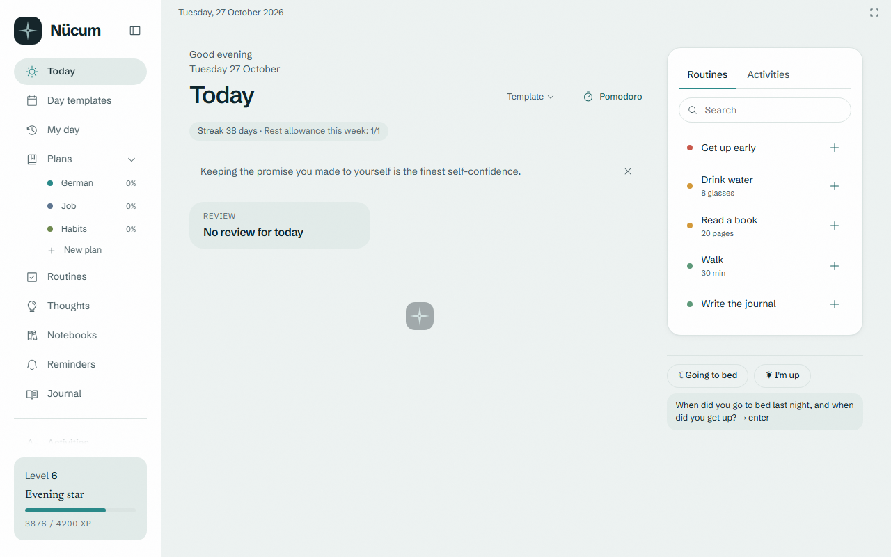

<sub>Screenshots show the generated <b>demo pack</b> (<code>npm run demo-pack</code>), not personal data. The UI is in Turkish.</sub>

</div>

---

## At a glance

<div align="center">

| 24 | 46 | 1,250+ | 530 | 25 days |
|:--:|:--:|:--:|:--:|:--:|
| backend modules<br/><sub>19 modules + 5 extensions</sub> | architecture<br/>decision records | automated tests<br/><sub>unit · integration · architecture · e2e · fidelity</sub> | documented concepts<br/><sub>generated from code comments</sub> | first commit → v0.18.3<br/><sub>19 desktop phases, 5 phone stages</sub> |

</div>

---

## 🧭 The product

Nücum replaces three separate study/habit trackers with **one app and one "Today" screen**: what to do now, what comes next, and how the day is going. Everything runs on the user's own computer — **no cloud account, no server**. The phone carries its own copy and syncs when it is near.

| | |
|---|---|
| **Today** | A queue built from an ideal-day template (or by hand), one focused card at a time, a focus timer (stopwatch / Pomodoro), "close the day" with energy and a note for tomorrow. |
| **Routines** | Check, count, duration and multi-part routines; time groups, templates, effective-dated targets, list / card / calendar views. |
| **Plans** | A generic plan engine: roadmap, checklist, topic tracker, notebook, exam tracker, kanban… with a wizard, a template gallery and a versioned editor. No plan is hard-coded. |
| **Streaks · XP · Achievements** | Template-aware streaks with rest days, an XP ledger projected from the event log, 105 achievements, milestone celebrations. |
| **Insights** | Heat maps, sleep ↔ work correlation, a report card, a weekly review, plan-drift forecasts. |
| **Review** | Leitner spaced repetition and interview drills with voice recording. |
| **Speed** | Ctrl+K command palette, full-text search with Turkish folding, a global-shortcut quick-capture window, tray menu. |
| **Data safety** | Automatic backups, online restore, JSON / CSV / Excel export, a pre-upgrade backup before every schema change. |
| **Phone** | QR pairing, offline-first replica, two-way sync, conflict log, resumable media upload. |
| **Browser extension** | Pomodoro and focus mode in Chrome/Edge — keeps working while the desktop app is closed. |

<table>
<tr>
<td width="50%">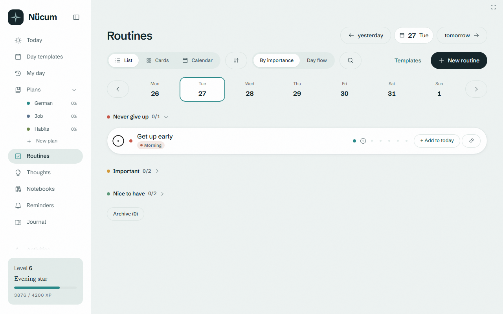<br/><sub><b>Routines</b> — check, count, duration and multi-part</sub></td>
<td width="50%">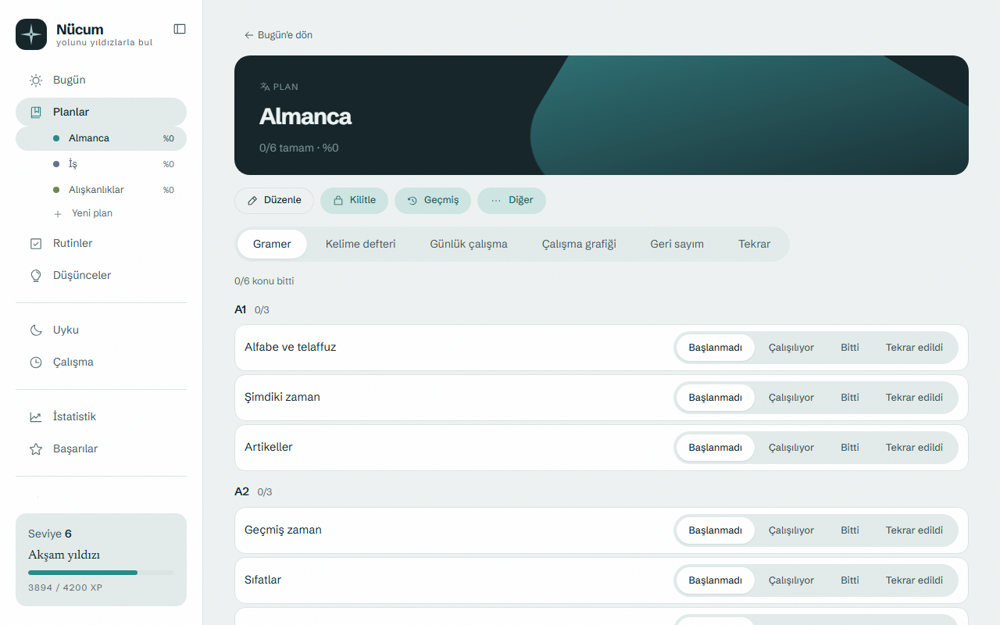<br/><sub><b>Plan engine</b> — modules configured as data</sub></td>
</tr>
<tr>
<td>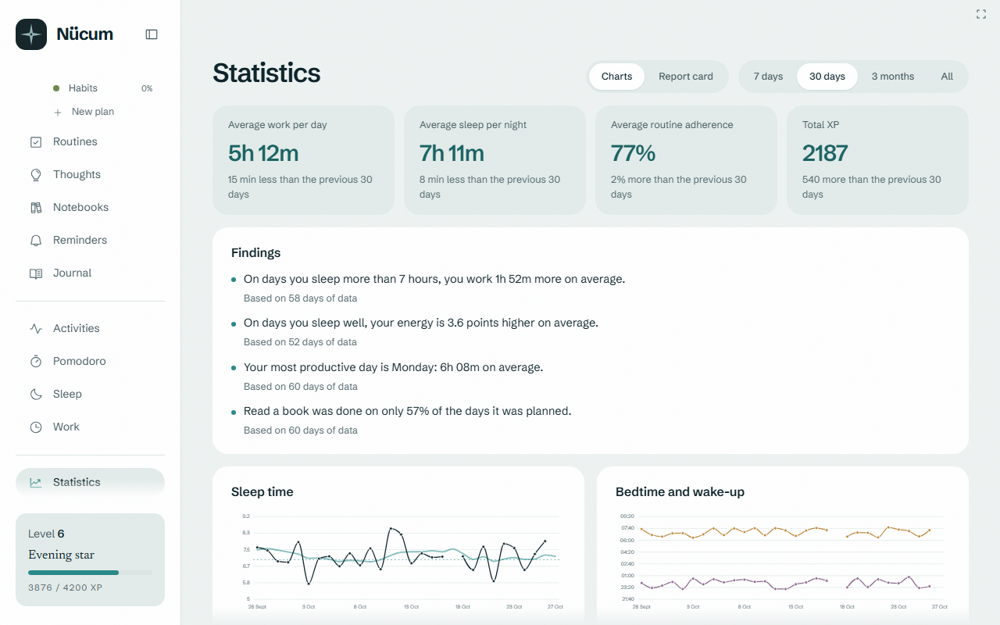<br/><sub><b>Insights</b> — computed from the event log in 5–120 ms on two years of data</sub></td>
<td>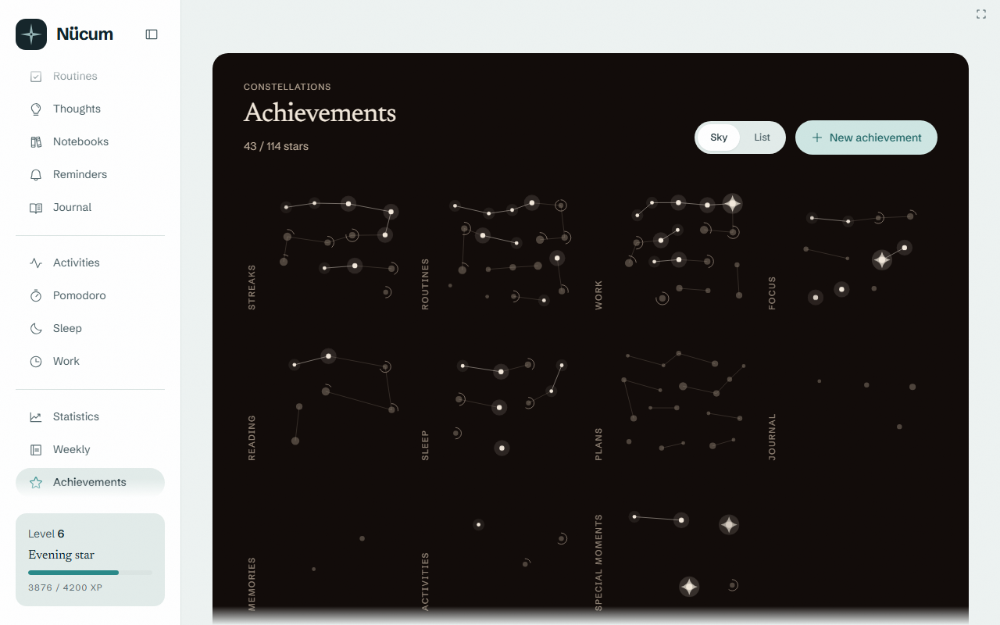<br/><sub><b>Achievements</b> — defined as data, evaluated from projections</sub></td>
</tr>
<tr>
<td>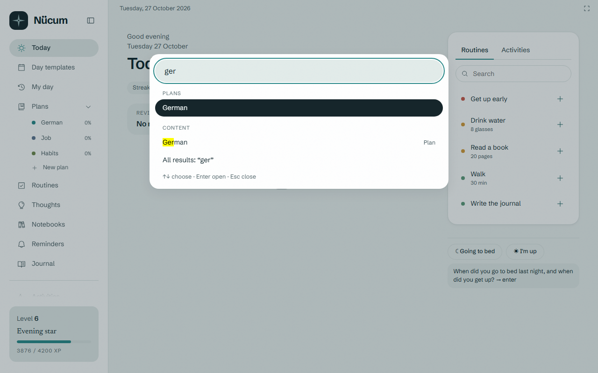<br/><sub><b>Command palette</b> — pages, actions and FTS5 search in one box</sub></td>
<td>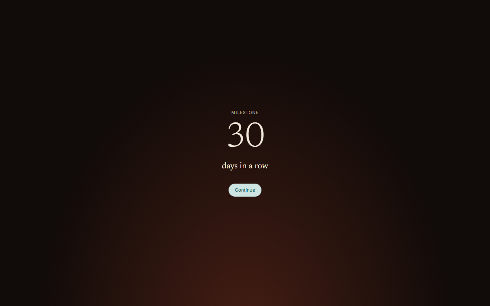<br/><sub><b>Celebrations</b> — milestones are rewarded, not just saved</sub></td>
</tr>
</table>

---

## 🏗 Architecture in one picture

<picture>
  <source media="(prefers-color-scheme: dark)" srcset="images/diagrams/architecture-overview-dark.png" />
  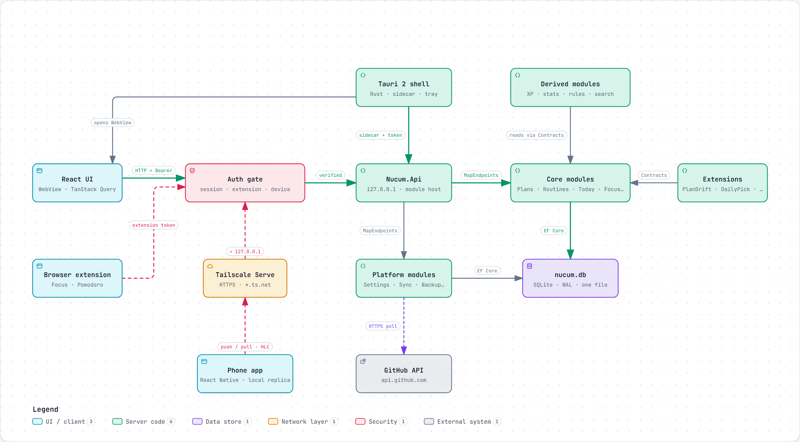
</picture>

**Read it in five lines:**

1. **The shell** (Tauri 2, Rust) starts the API as a **sidecar** with a fresh random token, waits for `/health`, then shows the window.
2. **The API** (ASP.NET Core 10) listens on **127.0.0.1 only** and hosts 24 modules in one process — each with its own `DbContext`, all sharing one SQLite file.
3. **Three clients, three keys:** the UI (session token), the browser extension (a narrow allow-list token), the phone (a hashed device token).
4. **The phone** never sees the LAN: it comes in through **Tailscale Serve** (TLS + identity, private tailnet).
5. **Every write** also lands in a change log in the same transaction; clients get a **"something changed" hint** over SignalR and pull the data themselves.

<sub>Every box in every diagram is linked to its source file and line in the interactive HTML versions: <a href="https://erkamucan.github.io/nucum-showcase/"><b>the interactive gallery</b></a> (zoom, search, trace a path, light/dark). Made with <a href="https://github.com/tt-a1i/archify">Archify</a> from repository evidence.</sub>

---

## ✨ Engineering highlights

Each section opens with the idea in one sentence. Click to see the diagram and the code.

### 1. A modular monolith whose boundaries are tested, not hoped for

> 19 modules + 5 extensions in one process. A module may reference another module **only through its `*.Contracts` project** — and architecture tests fail the build if it doesn't.

<details>
<summary><b>How it is enforced</b></summary>

- Every module implements one small contract — `RegisterServices`, `MapEndpoints`, `MigrateAsync` ([INucumModule.cs](code-samples/backend/src/Nucum.SharedKernel/Modules/INucumModule.cs)). The host registers them from an **explicit list** (ModuleHost.cs) — an early assembly-scan version found *zero* modules at runtime, because .NET loads a DLL only when a type in it is touched.
- **NetArchTest** checks the compiled assemblies ([LayerRulesTests.cs](code-samples/backend/tests/Nucum.ArchitectureTests/LayerRulesTests.cs)):
  - a module references peers only through `.Contracts`;
  - endpoints never touch EF Core or `Infrastructure`;
  - endpoints ask DI for **nothing but `IDispatcher`** — the test reads the parameters of the compiler-generated methods behind minimal-API lambdas;
  - only `Endpoints/` maps routes; handlers live in `Application/`.
- One SQLite file, many `DbContext`s: EF Core's `EnsureCreated` checks for the *file*, not the tables, so a small idempotent schema tool generates each module's DDL and runs it with `IF NOT EXISTS`, then reconciles indexes ([ModuleSchema.cs](code-samples/backend/src/Nucum.SharedKernel/Modules/ModuleSchema.cs)).

</details>

### 2. A home-made CQRS pipeline with errors as values

> Endpoint → dispatcher → `Logging → Validation → Handler` → `Result<T>` → one place that maps errors to HTTP (RFC 9457 ProblemDetails). No MediatR, no exceptions for expected failures.

<details>
<summary><b>The request pipeline</b> — "start a focus session", end to end</summary>
<br/>
<picture>
  <source media="(prefers-color-scheme: dark)" srcset="images/diagrams/request-pipeline-dark.png" />
  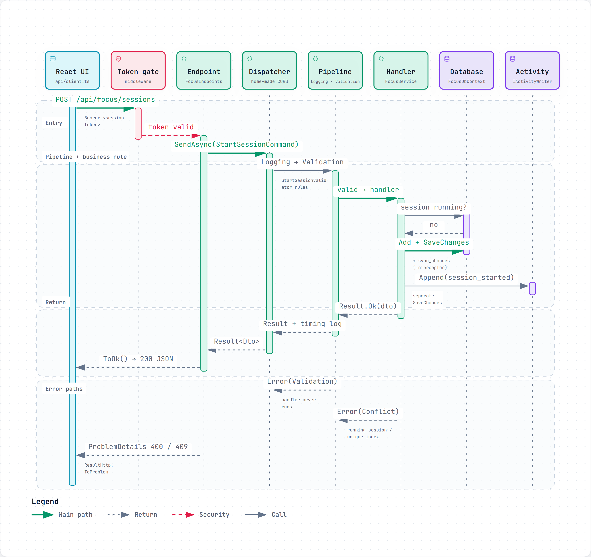
</picture>

The dispatcher builds the closed handler type once by reflection, caches it, and wraps the registered behaviours around it ([Dispatcher.cs](code-samples/backend/src/Nucum.SharedKernel/Messaging/Dispatcher.cs), abridged):

```csharp
var handler = services.GetRequiredService(info.Handler);
Func<Task<Result<TResult>>> next = () => (Task<Result<TResult>>)info.Handle.Invoke(handler, [message, ct])!;

var behaviours = services.GetServices(info.Behaviour).Cast<object>().Reverse().ToList();
foreach (var b in behaviours)
{
    var current = next;
    next = () => (Task<Result<TResult>>)info.BehaviourHandle.Invoke(b, [message, current, ct])!;
}
return await next().ConfigureAwait(false);
```

- **Races are caught by the database, not by hope:** "at most one running session" is a unique index; the losing request turns its `DbUpdateException` into a `409` with the running session's id.
- Handlers return `Result<T>`; `ResultHttp` is the only file that knows status codes.

</details>

### 3. An append-only event log, projections, and no midnight jobs

> Every user action is appended to a log that is never updated. XP, streaks and statistics are **projections** that can be thrown away and rebuilt — and they **catch up on read**, so nothing has to run at 04:00 while the laptop sleeps.

<details>
<summary><b>What happens when a focus session ends</b></summary>
<br/>
<picture>
  <source media="(prefers-color-scheme: dark)" srcset="images/diagrams/event-flow-dark.gif" />
  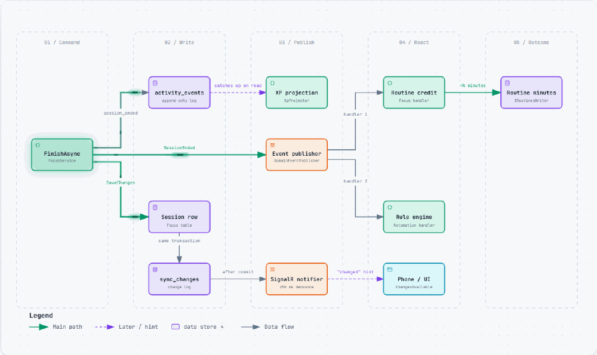
</picture>
<sub>Animated: each pulse follows one write or event in step order. The interactive version can pause, zoom and trace a path.</sub>

- **Deterministic + idempotent projection:** the same events always produce the same XP lines with the same ids; a test rebuilds the ledger and compares ([XpProjector.cs](code-samples/backend/src/Modules/Gamification/Nucum.Modules.Gamification/Application/XpProjector.cs)).
- **Cache keyed by the change log:** the gamification summary is cached under *(latest `sync_changes` number, logical day)* — a version every write already maintains, instead of a guessed TTL. Two years of data: from ~300 ms per read to a cache hit.
- **A real race, found by a test:** the daily summary used read-then-write; 60 parallel writes produced lost updates. Fixed with `INSERT … ON CONFLICT DO UPDATE` in the same transaction.

</details>

<details>
<summary><b>The lifecycle of a "logical day"</b> — the day ends at 04:00, not midnight</summary>
<br/>
<picture>
  <source media="(prefers-color-scheme: dark)" srcset="images/diagrams/day-lifecycle-dark.png" />
  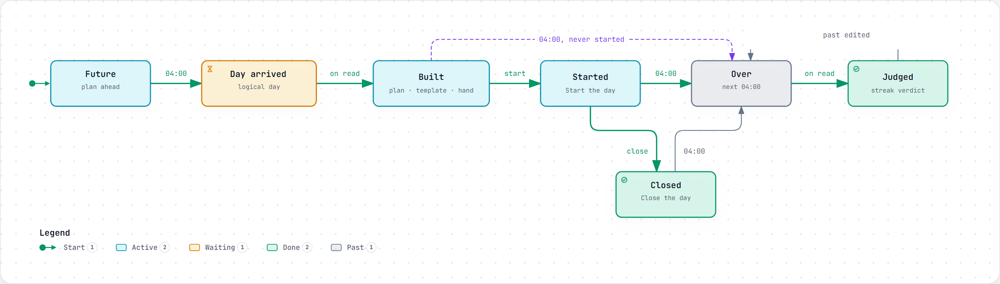
</picture>

Work logged at 01:30 counts for "last night". One service decides what "today" is; timestamps are stored in UTC and the logical date next to them. Plans made ahead, streak verdicts and XP are applied **on the first read** of a day, idempotently — two devices reading at once is harmless.

</details>

### 4. Offline-first phone sync: HLC, per-field last-writer-wins, three layers of idempotency

> The phone works fully offline from its own SQLite replica. Sync is **push the outbox, then pull after a cursor**; conflicts are decided **per field** by a **Hybrid Logical Clock**, and a retried push can never apply twice.

<details>
<summary><b>The protocol</b> — pairing, push, pull, live hint</summary>
<br/>
<picture>
  <source media="(prefers-color-scheme: dark)" srcset="images/diagrams/phone-sync-dark.gif" />
  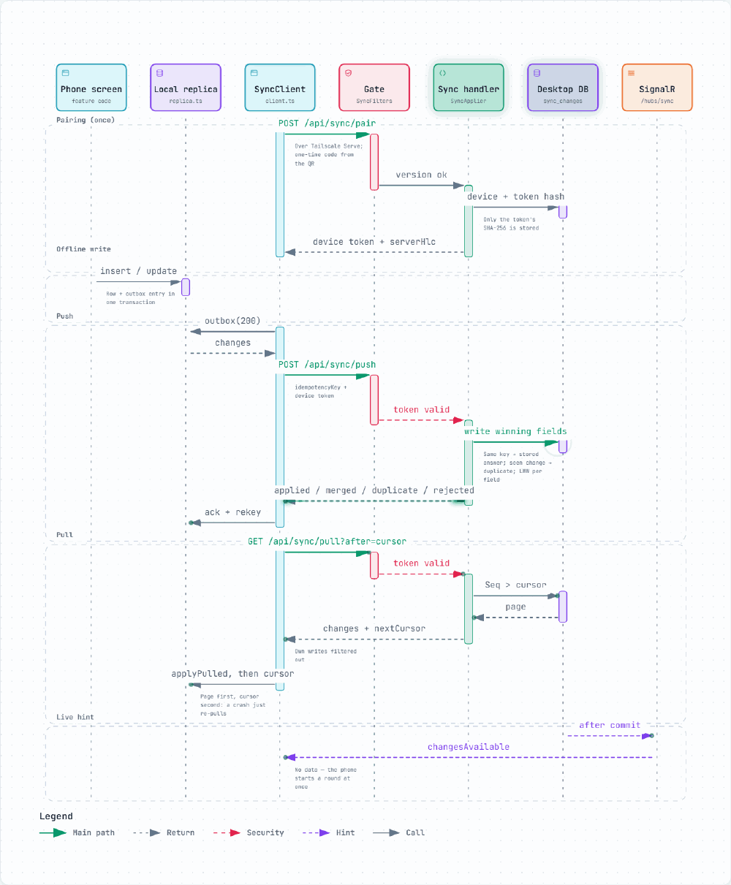
</picture>
<sub>Animated: the messages play in protocol order. The interactive version can pause, zoom and trace a path.</sub>

**Retry safety, three layers deep** ([SyncApplier.cs](code-samples/backend/src/Modules/Sync/Nucum.Modules.Sync/Application/SyncApplier.cs)):

| Layer | Catches |
|---|---|
| Batch idempotency key → stored response returned as-is | the answer was lost, the phone resent the same batch |
| Inbox of change ids → `duplicate` | the phone rebuilt its batch, an old change came in a new one |
| Equal HLC → no-op | the server wrote the row but crashed before writing the inbox |

**Per-field LWW with "was it really concurrent?"** ([FieldMerge.cs](code-samples/backend/src/Modules/Sync/Nucum.Modules.Sync/Domain/FieldMerge.cs), abridged):

```csharp
var cmp = incoming.CompareTo(cur.Hlc);
if (cmp == 0) { decisions.Add(new FieldDecision(field, FieldOutcome.Duplicate, false, cur)); continue; }
var otherDevice = cur.Hlc.Node != incoming.Node;
var unseen = baseHlc is not { } b || cur.Hlc > b;       // edited without seeing the other write?
decisions.Add(new FieldDecision(field, cmp > 0 ? FieldOutcome.Win : FieldOutcome.Lose, otherDevice && unseen, cur));
```

Two devices editing *different* fields of one row both keep their edit. A truly concurrent edit of the *same* field is logged, and the user can pick the losing value back. Why HLC and not UTC timestamps? A phone whose clock is three minutes behind would lose every edit.

Also: device id in the HLC must match the sender, clocks far in the future are rejected, keyset pagination on a monotonic sequence, the phone's own writes are filtered out of its pull, and the change log is compacted below the slowest phone's cursor.

</details>

<details>
<summary><b>The schema behind it</b></summary>
<br/>
<picture>
  <source media="(prefers-color-scheme: dark)" srcset="images/diagrams/sync-schema-dark.png" />
  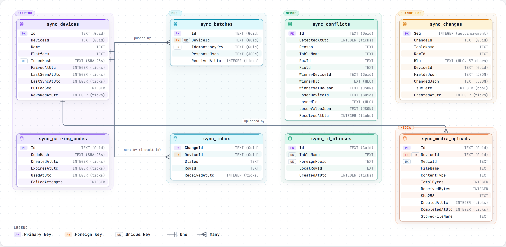
</picture>

</details>

### 5. One write path, stamped by an interceptor

> No handler can forget sync metadata: an EF Core `SaveChanges` interceptor stamps `UpdatedAtUtc` / `DeviceId`, turns deletes into **tombstones**, and appends the change-log row **in the same transaction**.

<details>
<summary><b>The interceptor</b></summary>

```csharp
switch (entry.State)
{
    case EntityState.Deleted:
        entry.State = EntityState.Modified;   // DELETE becomes UPDATE …
        entry.Entity.DeletedAtUtc = now;      // … and leaves a tombstone
        goto case EntityState.Modified;
    case EntityState.Added:
    case EntityState.Modified:
        entry.Entity.UpdatedAtUtc = now;
        entry.Entity.DeviceId = device.Current;
        break;
}
```
([SyncFields.cs](code-samples/backend/src/Nucum.SharedKernel/Persistence/SyncFields.cs)) — plus a global query filter (`WHERE DeletedAtUtc IS NULL`) built as an expression tree per entity type, and unique indexes rewritten as partial so a tombstone never blocks a new row. IDs are **UUIDv7**: created on the device, collision-free offline, and index-friendly.

</details>

### 6. Security for a local app, done properly

> API on loopback only · CORS limited to the shell's origins · three token kinds, each opening different doors · secrets stored as hashes or in the OS vault · personal content scanned out of git **and out of the installer payload**.

<details>
<summary><b>Details</b></summary>

| Secret | Stored as |
|---|---|
| Session token | never stored — random per launch, handed to the WebView by a Tauri command |
| Device token | SHA-256 only; revocable per device |
| Journal PIN | salted PBKDF2-SHA256 (120,000 rounds), constant-time compare; the unlock key lives in RAM only |
| GitHub token | Windows Credential Manager (DPAPI); never in the database, logs, backups or exports |

- The browser extension's token is checked against a single **method + path allow-list** ([ExtensionScope.cs](code-samples/backend/src/Nucum.Api/Infrastructure/ExtensionScope.cs)) — least privilege without an OAuth server.
- A `nucum://` deep link only brings the window forward; its path is never read.
- The list of personal words to guard is **read from the git-ignored personal pack**, never written into the code — a hard-coded blacklist would itself be the leak.

</details>

### 7. Documentation that is generated from the code

> 530 `CONCEPT:` comments and 116 `INTERVIEW:` comments in the source are compiled into a concept index and an interview question bank by `npm run rehber:index` — and `--check` fails when they drift.

The code is written to be read: every file opens with a summary, and important places carry tagged comments (`CONCEPT`, `WHY`, `GOTCHA`, `INTERVIEW`). A 20-chapter learning guide (Turkish) in the private repository walks through the whole system with analogies, technical mappings, code links and exercises.

---

## 🧰 Stack

| Layer | Choice | Why |
|---|---|---|
| Runtime / API | .NET 10, ASP.NET Core Minimal API | Portfolio centre of gravity; minimal ceremony per module |
| Messaging | Own CQRS dispatcher + pipeline behaviours | MediatR became commercial; ~100 lines, fully understood |
| Validation | FluentValidation | Apache-2.0 |
| Data | EF Core 10 + SQLite (WAL), one `DbContext` per module | Zero-install, one file, easy backup |
| Realtime | SignalR (hints only) | One data path; a lost hint costs nothing |
| Desktop shell | Tauri 2 (Rust) + WebView2 | Small footprint; the API runs as a sidecar |
| UI | React 19, TypeScript strict, Vite, TanStack Router + Query, Zustand, React Aria | Typed routes, server-state cache, accessible headless components |
| API types | OpenAPI → `openapi-typescript` | A renamed DTO field breaks `tsc`, not production |
| Charts | d3-scale + d3-shape, own SVG | No "chart library look" |
| Phone | React Native (Expo), expo-sqlite | Offline-first replica |
| Network | Tailscale Serve | TLS + identity + NAT traversal, no open ports |
| Tests | xUnit, Shouldly, NetArchTest, Vitest, Jest, Playwright + axe | No commercially-licensed test libraries |

---

## ✅ Quality

| Gate | What it proves | Size <sub>(at 0.18.2)</sub> |
|---|---|---|
| Architecture tests | module boundaries and layer rules hold | 114 |
| Integration tests | the real pipeline against a real temporary SQLite file (`WebApplicationFactory` + `TestServer`) | 332 |
| Unit tests (web) | hooks, pure helpers, guards | 554 |
| Shell tests | Tauri commands through the real IPC path | 4 |
| Fidelity tests | source plan content is carried over **byte for byte** | 79 |
| End-to-end | Playwright on the production build: behaviour + **axe accessibility** | 176 |
| Smoke | the packaged sidecar + production build, from the installed app's origin | before every installer |

Also on every `npm run lint`: type check, ESLint, **personal-content scan**, version consistency across seven files, freshness of generated tokens. Guard tests fail on hard-coded UI text (parsed with the TypeScript compiler API), hard-coded colours and low contrast.

The phone's real TypeScript sync client is tested against a **real desktop API** with a temporary database (`npm run mobile:sync-check`), and the backend has a C# reference phone client for the same protocol.

---

## 📅 How it was built

<picture>
  <source media="(prefers-color-scheme: dark)" srcset="images/diagrams/development-timeline-dark.png" />
  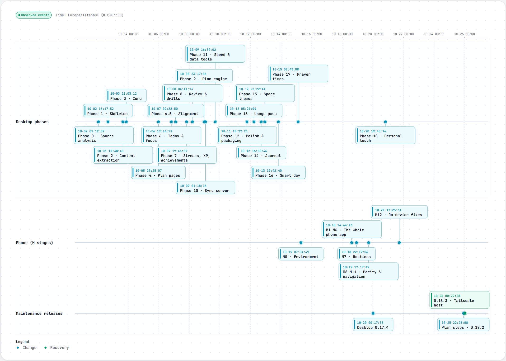
</picture>

Built in **phases with explicit acceptance criteria**: each phase ends only when five gates are green together (lint, build, tests, fidelity, e2e), with a written report and screenshots. Every significant decision is an [ADR](adr/) (46 so far); smaller ones are logged in a decision journal.

---

## ⚖️ Honest trade-offs

Things I would point out myself in a review:

| Trade-off | Why it is acceptable today | Next step |
|---|---|---|
| Domain events are published in-process after `SaveChanges` — **no outbox** for them | Single process, single database; handlers are idempotent and commands are safe to repeat | A transactional outbox + processor |
| Cross-module writes are separate `SaveChanges` calls | Each module owns its `DbContext` by design | Idempotent handlers (in place) or a shared transaction scope |
| In-process locks (`SemaphoreSlim`) for a few check-then-act paths | One API process per machine | A database lock or unique index for multi-server |
| Schema tool is SQLite-specific (`IF NOT EXISTS`) | Many `DbContext`s in one file; Migrations add ceremony | EF Migrations if moving to PostgreSQL |
| Architecture-test list is maintained by hand (5 modules missing) | Rules hold on the 19 covered modules | Generate the list from the module registry |

---

## 🔒 Source code

The application lives in a private repository. This showcase contains:

- [`code-samples/`](code-samples/) — 19 representative files copied unchanged (request pipeline, module boundaries, sync, projections, security) with a guide to what each one shows;
- [`adr/`](adr/) — all 46 architecture decision records;
- [the interactive diagram gallery](https://erkamucan.github.io/nucum-showcase/) — every box linked to the file and line it was drawn from.

I am happy to walk through the full code base in a call.

---

## 📚 In this repository

| Path | What it is |
|---|---|
| [`code-samples/`](code-samples/) | Selected source files with a reading guide |
| [`adr/`](adr/) | 46 architecture decision records (context, decision, alternatives, consequences) |
| [`docs/`](docs/) | The GitHub Pages site: [interactive diagrams](https://erkamucan.github.io/nucum-showcase/) |
| [`images/`](images/) | Screenshots (demo data) and diagram renders |


<div align="center">
<sub>Built by Erkam Uçan as a personal tool and a backend-engineering portfolio project.</sub>
</div>
